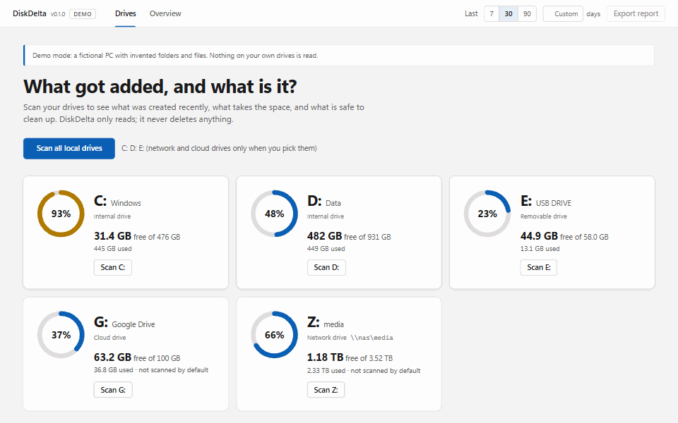
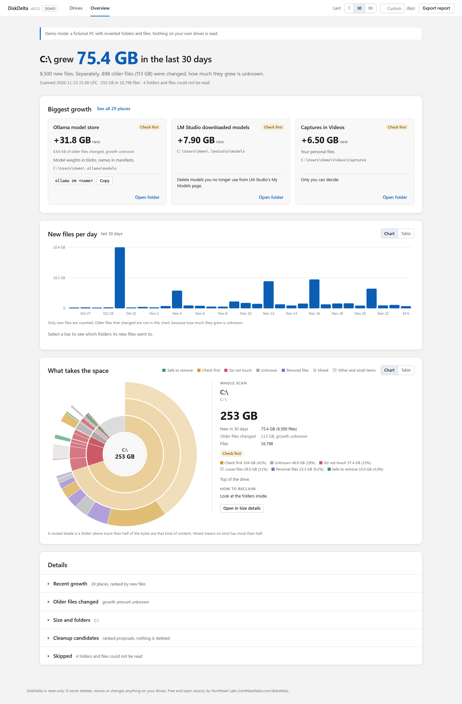
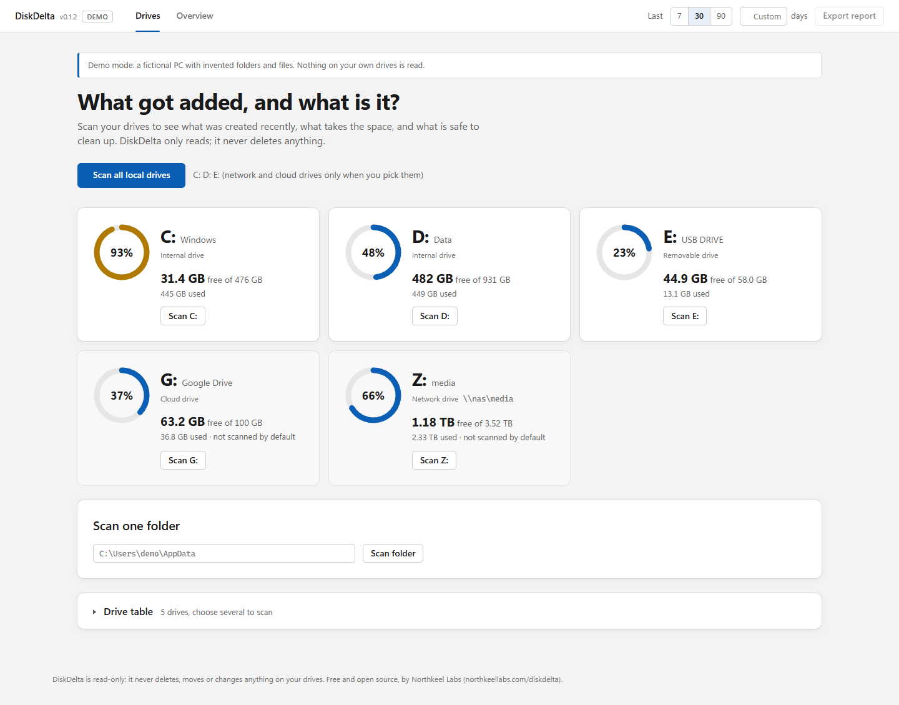

# DiskDelta

**My drive is filling up. What got added recently, and what is safe to remove?**

DiskDelta is a free, open-source Windows tool that answers that question for you (a page in your browser) and for your AI (a read-only MCP server for Claude Desktop, Claude Code and other MCP apps). It only reads: it never deletes, moves or changes anything on your drives.



*Walkthrough and screenshots show the built-in demo (`diskdelta --demo`): a fictional PC with invented folders and files.*

**Try it in your browser:** [`docs/demo/index.html`](docs/demo/index.html) is the same page running entirely in the browser on the fictional PC. It needs no install and reads nothing from your computer. Open it locally after cloning, or host it as a single static file.



## What it does

- **Drives:** a card per drive with a fullness ring, used and free space, and a Scan button; "Scan all local drives" scans every internal and USB drive. Network and cloud drives are listed but not scanned unless you pick them.
- **Overview after a scan:** one sentence with the headline number (new files only, for example "C:\ grew 75.4 GB in the last 30 days"), the three places that grew most with their label and the way to reclaim them, a bar chart of new files per day (select a day to see which folders it went to), and a sunburst of what takes the space that you can click through. Every chart has a table view and works with the keyboard.
- **Recent growth:** everything created in the last 7, 30, 90 or any number of days, totalled per folder and drillable down to files. Older files that were modified recently are a separate figure, "changed, growth amount unknown", because file dates cannot tell how much they grew; the two are never added together.
- **Details:** below the overview, expandable sections keep the full sortable tables: all growth places, changed older files, size by folder with a treemap, cleanup candidates and skipped folders.
- **Labels:** each known folder gets **Safe to remove**, **Check first** or **Do not touch**, a one-line "what this is" and "how to reclaim", preferring the owning app's own command (for example `ollama rm <name>`, `docker system prune`, `npm cache clean --force`). Folders without a rule show as **Unknown, check first**, with a hint about which app owns them.
- **Cleanup plan:** a ranked list of candidates. DiskDelta proposes; you decide and act.
- **Skipped:** folders it could not read (usually system folders that need admin rights) are listed with the reason, not silently ignored.
- **Export:** the report as Markdown or HTML, to a file you choose.



## Quick start

**Portable exe (no install, no admin):** download `diskdelta-<version>-win-x64.exe` from the [releases page](https://github.com/northkeellabs/diskdelta/releases), check it against `SHA256SUMS.txt`, and double-click it. It opens the page in your default browser on `http://127.0.0.1` and stops when you close the page.

The exe is not code-signed yet, so Windows SmartScreen may warn you the first time ("Windows protected your PC"). Check the SHA-256 checksum first (`Get-FileHash .\diskdelta-0.1.1-win-x64.exe`), then choose "More info", "Run anyway".

**With Node.js 22 or newer:** (the npm package is not published yet; until it is, clone this repo, run `npm ci` and `npm run build`, and use `node dist/cli.js` wherever `npx diskdelta` appears below)

```
npx diskdelta            # open the page
npx diskdelta --demo     # the same page on a fictional PC
npx diskdelta scan C:\   # scan in the terminal and print a summary
```

Options: `--port N`, `--no-open`, `--idle-minutes N`, `--days N`, `--limit N`, `--json FILE` (scan only; writes a new file, never overwrites). Environment variables: `DISKDELTA_PORT`, `DISKDELTA_IDLE_MINUTES`, `DISKDELTA_DATA_DIR`.

## Use it from your AI (MCP)

`diskdelta mcp` runs a read-only MCP server over stdio.

| Tool | What it returns |
| --- | --- |
| `drive_overview()` | Drives with type, size, used, free and fullness |
| `what_grew(path, days, limit)` | Where new and changed files are, as non-overlapping rows with labels, plus big old files that changed recently |
| `explain(path)` | What a folder is, which app probably owns it, its label and how to reclaim the space |
| `cleanup_plan(path, days, limit)` | Ranked cleanup candidates with size, recent growth, label, reason and how to reclaim |

All four are marked read-only. There is no tool that deletes, moves or changes anything. `what_grew` and `cleanup_plan` scan the path on demand and reuse a scan from the last 15 minutes; a whole drive can take minutes, so asking about a folder (your profile, AppData) is faster.

**Claude Desktop:** Settings, Developer, Edit Config, and add to `claude_desktop_config.json`:

```json
{
  "mcpServers": {
    "diskdelta": { "command": "npx", "args": ["-y", "diskdelta", "mcp"] }
  }
}
```

With the exe instead of Node, use the full path to the exe as `command` and `["mcp"]` as `args` (backslashes doubled in JSON). Restart Claude Desktop.

**Claude Code:**

```
claude mcp add diskdelta -- npx -y diskdelta mcp
```

Other MCP apps: run `npx -y diskdelta mcp` (or `diskdelta.exe mcp`) as a stdio server. Add `--demo` to try it on the fictional PC.

## How it decides what is safe

Labels come from one data file, [`rules/rules.json`](rules/rules.json), validated by [`rules/rules.schema.json`](rules/rules.schema.json). Each rule has an id, one or more path patterns, a label, a one-line "what", a "reclaim" step, optional notes, and examples that must and must not match (tested).

1. Patterns start at a Windows location (`%TEMP%`, `%LOCALAPPDATA%`, `%APPDATA%`, `%USERPROFILE%`, `%PROGRAMDATA%`, `%PROGRAMFILES%`, `%WINDIR%`), at any drive (`?:`), or anywhere (`**`, for folder names like `node_modules`). They are matched against the path and its parent folders, case-insensitively.
2. The most specific match wins: the deepest matching folder, then the pattern with more fixed parts. So a cache inside a browser profile is **Safe to remove** while the profile itself is **Check first**.
3. A rule that matches by folder name anywhere cannot soften a **Do not touch** folder above it: `node_modules` inside `Program Files` stays **Do not touch**.
4. Nothing inside your personal folders (Documents, Desktop, Pictures, Videos, Music, OneDrive, Downloads) is ever labelled **Safe to remove**; a `node_modules` in Documents becomes **Check first**.
5. Many sibling folders in your temp folder that share a name prefix (for example dozens of `vitest-...` folders) are recognised as leftovers of repeated test or build runs and grouped.
6. No rule: **Unknown, check first**, with the owning app guessed from the folder below AppData, ProgramData or Program Files.

**Safe to remove** means the content is rebuilt or downloaded again when needed, or is already deleted (the Recycle Bin). It does not mean "no consequence": a cleared cache makes the next start slower, and a removed model must be downloaded again. **Check first** means only you can decide. **Do not touch** means removing it by hand breaks something; the reclaim step says what to do instead.

What "recent" means: a file counts when it was created or modified within the window. Files copied or extracted recently keep their old modified date but get a new creation date, so they count as new. A file created before the window and modified inside it is shown at its full size as "changed, growth amount unknown".

## Adding rules

Rules are data, so anyone can add one by pull request. See [CONTRIBUTING.md](CONTRIBUTING.md). In short: add an entry to `rules/rules.json` with at least one `match` and one `no_match` example, prefer the owning app's own cleanup command in `reclaim`, never label personal data **Safe to remove**, and run `npm test` and `npm run eval`.

## Privacy and security

- Read-only: the scanner calls only `readdir` and `lstat`; a test spies on every file system function to prove nothing is opened for writing. The only files DiskDelta writes are its own snapshots (`%LOCALAPPDATA%\DiskDelta\snapshots`, last 10 kept) and a report you export.
- Offline: no telemetry, no update check, no fonts or scripts from the internet. The page talks only to the local server on `127.0.0.1`. The only data that leaves your PC is what your own AI app receives through MCP.
- No admin rights needed, never requested. Symlinks and junctions are not followed.
- The local server needs a random per-run token, checks the Host header and refuses cross-origin requests. Details in [SECURITY.md](SECURITY.md).

## Limits (v0)

- **It cannot clean.** v0 shows and proposes; you remove things yourself, preferably with each app's own command.
- **Growth amount unknown for old files** that changed recently (for example a virtual disk). Exact growth needs a comparison with an earlier snapshot, planned for v1. v0 already saves the snapshots.
- A whole-drive scan is a normal folder walk and can take minutes on a large drive. Folders that need admin rights are skipped and listed.
- Sizes are file lengths (apparent size); allocated size on disk is counted too. OneDrive and other cloud placeholders count at their full size even when not downloaded.
- Windows 10 and 11 only. The rules cover common apps; anything else shows as Unknown.

## Build from source

Needs Node 22 or newer.

```
npm ci
npm test            # vitest: scanner, growth, rules, snapshots, core, MCP, local server, offline checks
npm run eval        # label eval on tests/eval/paths.json
npm run typecheck
npm run build       # dist/cli.js (npm package)
npm run build:exe   # dist/release: portable exe (Node single executable application) and SHA256SUMS.txt
npm run demo        # the page on the fictional PC
npm run build:demo  # docs/demo/index.html: the static browser demo (no server)
```

`node scripts/screenshots.mjs <folder>` and `node scripts/record-gif.mjs docs/walkthrough.gif` regenerate the screenshots and the walkthrough from demo mode with a headless Edge or Chrome.

Layout: `src/scanner` (folder walk and demo PC), `src/growth` (recent-growth detector), `src/rules` (rules engine), `src/snapshot` (snapshot format and store), `src/drives`, `src/core` (the API the page and the MCP server both use), `src/mcp`, `src/ui` (local server and the single-file page), `rules/`, `tests/`.

## More from Northkeel Labs

- [brand-mcp-sample](https://github.com/northkeellabs/brand-mcp-sample): an MCP server that gives AI agents a brand's design tokens and rules.
- [northkeellabs.com](https://northkeellabs.com)

## Licence

MIT, see [LICENSE](LICENSE).

---

Built by [Northkeel Labs](https://northkeellabs.com): AI agents and MCP servers that run inside your own systems.
